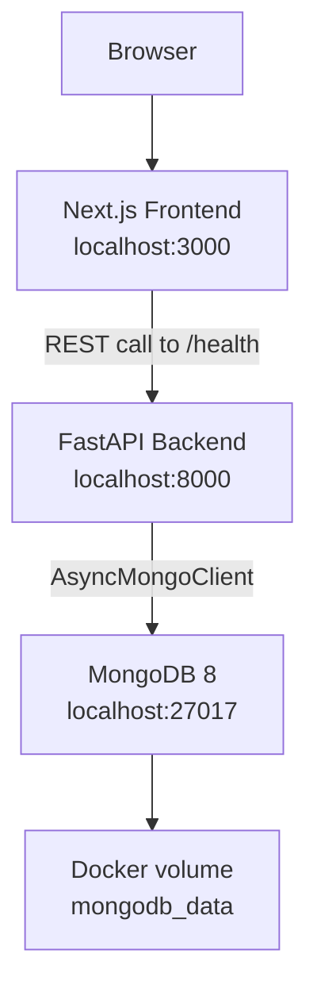

# Architecture

## Overview

The GIBZ Room Rental application is intended to replace the current PDF-based reservation workflow with a web application. The current repository contains the technical baseline for that system: a Next.js frontend, a FastAPI backend, and a MongoDB database, all started through Docker Compose.

This document separates the implemented architecture from the planned final architecture so that the documentation stays aligned with the current codebase.

## Implemented Architecture



Current services:

| Service | Technology | Port | Purpose |
|---|---|---|---|
| `frontend` | Next.js 16, React 19, TypeScript | 3000 | Displays the current starter UI and backend health status |
| `backend` | FastAPI, Python 3.12, Pydantic | 8000 | Exposes health and reservation API endpoints |
| `mongodb` | MongoDB 8 | 27017 | Stores reservation documents |

The application is currently a small modular monolith: one backend application contains the API routes and database connection logic. MongoDB is accessed directly from the reservation router. The planned DAO layer has not been implemented yet.

## Current Backend

The backend entry point is `backend/app/main.py`.

Implemented behavior:

- Creates a FastAPI application with the configured app name.
- Configures CORS from the `CORS_ORIGINS` environment variable.
- Pings MongoDB during application lifespan startup.
- Mounts the reservation router.
- Provides `GET /` and `GET /health`.

Implemented reservation API:

| Endpoint | Purpose |
|---|---|
| `POST /reservations` | Creates a reservation document in MongoDB |
| `GET /reservations` | Lists reservation documents sorted by creation date descending |

Current reservation fields:

```json
{
  "id": "string",
  "room_id": "string",
  "contact_name": "string",
  "contact_email": "email",
  "date": "string",
  "start_time": "string",
  "end_time": "string",
  "notes": "string | null",
  "created_at": "datetime"
}
```

Current validation:

- `room_id` must not be empty.
- `contact_name` must not be empty.
- `contact_email` must be a valid email address.
- Other date/time fields are currently strings and do not yet enforce full business rules such as valid ranges or overlap checks.

## Current Frontend

The frontend entry point is `frontend/src/app/page.tsx`.

Implemented behavior:

- Renders a simple Room Rental starter page.
- Calls `getHealth()` from `frontend/src/lib/api.ts`.
- Displays the backend health response as JSON.

The frontend API base URL is resolved in this order:

1. `API_BASE_URL`
2. `NEXT_PUBLIC_API_BASE_URL`
3. `http://localhost:8000`

The current frontend does not yet include room catalogue pages, reservation forms, customer edit pages, or a staff dashboard.

## Database Architecture

MongoDB is used as the NoSQL database. In Docker Compose, it stores data in the named volume `mongodb_data`.

Implemented collection:

| Collection | Purpose |
|---|---|
| `reservations` | Stores created reservation documents |

Planned collections:

| Collection | Purpose |
|---|---|
| `rooms` | Room definitions, capacity, equipment, prices, images, and setup variants |
| `staff` | Staff users and roles |
| `config` | Configurable values such as reminder and edit-deadline days |

MongoDB is appropriate for this project because reservation data can naturally grow into nested documents, for example with catering details, material requests, setup variants, reminder state, and status fields.

## Configuration

Backend settings are loaded through Pydantic Settings in `backend/app/config.py`.

| Variable | Default | Purpose |
|---|---|---|
| `APP_NAME` | `room-rental-api` | FastAPI application name |
| `MONGODB_URL` | `mongodb://localhost:27017` | MongoDB connection string |
| `MONGODB_DB` | `room_rental` | Database name |
| `CORS_ORIGINS` | `http://localhost:3000` | Allowed origins for browser requests |

Frontend settings are provided through Docker Compose:

| Variable | Value in Docker Compose | Purpose |
|---|---|---|
| `API_BASE_URL` | `http://backend:8000` | Backend URL for server-side frontend code |
| `NEXT_PUBLIC_API_BASE_URL` | `http://localhost:8000` | Backend URL for browser/client-side code |

## Planned Final Architecture

The final project should extend the current baseline with these modules:

- Room catalogue and room detail routes in the frontend.
- Reservation creation and customer edit forms.
- Staff login and staff dashboard.
- Backend routers for rooms, authentication, staff operations, and configuration.
- DAO classes for MongoDB collections so database access is no longer written directly in route handlers.
- Service layer for conflict detection, edit deadlines, reminder eligibility, and filtering.
- Optional reminder scheduler for incomplete catering/setup/material details.

Planned target structure:

```text
backend/
  app/
    routers/
      reservations.py
      rooms.py
      auth.py
    dao/
      reservation_dao.py
      room_dao.py
      staff_dao.py
    services/
      reservation_service.py
      reminder_service.py
    models/
      reservation.py
      room.py
      staff.py
```

The current code should be refactored toward this structure only as features are implemented. The documentation should not claim those modules exist until they are added.

## Backup and Restore

MongoDB data is stored in the Docker named volume `mongodb_data`. Manual backup and restore are possible with `mongodump` and `mongorestore`.

Backup:

```bash
docker exec room-rental-mongodb mongodump --db room_rental --archive=/tmp/room_rental_backup.archive
docker cp room-rental-mongodb:/tmp/room_rental_backup.archive ./backups/
```

Restore:

```bash
docker cp ./backups/room_rental_backup.archive room-rental-mongodb:/tmp/
docker exec room-rental-mongodb mongorestore --db room_rental --archive=/tmp/room_rental_backup.archive --drop
```

For the school project, manual backups before demos or larger changes are sufficient. A production deployment should add scheduled backups and MongoDB authentication.
