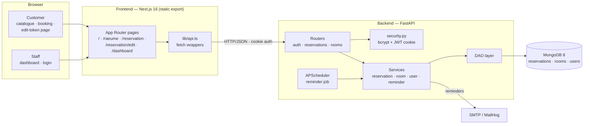

# System Architecture

The GIBZ Room Rental application replaces the PDF-based reservation workflow with
a web application: a Next.js frontend, a FastAPI backend, and a MongoDB database,
all started through Docker Compose.

## Component overview



## Services

| Service | Technology | Port | Purpose |
|---|---|---|---|
| `frontend` | Next.js 16, React 19, TypeScript, Tailwind 4 | 3000 | Catalogue, booking, customer edit page, staff dashboard |
| `backend` | FastAPI, Python 3.12, Pydantic | 8000 | REST API, auth, business rules, reminder scheduler |
| `mongodb` | MongoDB 8 | 27017 | Document store (`reservations`, `rooms`, `users`) |
| `mailhog` *(optional)* | MailHog | 8025 | Captures reminder emails for the demo |

## Backend layering

Requests flow strictly downward — each layer depends only on the one below:

```
HTTP request
  → router      (HTTP concerns, status codes, auth dependencies)
    → service   (business rules: conflict detection, edit deadline, reminders)
      → DAO     (all MongoDB queries; the only layer touching the driver)
        → MongoDB
```

- **Routers** (`app/routers/`) — translate HTTP ↔ domain and attach auth
  dependencies (`require_staff`, `require_role`). Kept thin.
- **Services** (`app/services/`) — conflict/overlap detection, customer edit
  deadline, reminder selection. Never import the driver.
- **DAOs** (`app/dao/`) — encapsulate every query (the module's required
  decoupling layer; also what enables the in-memory test mock).
- **Models** (`app/models/`) — Pydantic schemas; cross-field rules live in
  `model_validator(mode="after")`, so invalid input is rejected as **422** before
  reaching a handler.

## API endpoints

| Endpoint | Auth | Purpose |
|---|---|---|
| `POST /reservations` | public | Create a reservation; returns a one-time `edit_token` |
| `GET /reservations/availability` | public | Booked slots only (no PII) for the booking calendar |
| `GET /reservations/edit/{token}` | token | Load a reservation for customer editing |
| `PATCH /reservations/edit/{token}` | token | Edit catering/setup/remarks until the deadline (403 after) |
| `GET /reservations` | staff | List + filter (date range, catering, upcoming, past, status, `q`) |
| `GET /reservations/{id}` | staff | Single reservation |
| `PATCH /reservations/{id}` | staff | Update status / fields (conflict re-checked on reschedule) |
| `DELETE /reservations/{id}` | admin | Delete (higher-authority override) |
| `POST /auth/login` · `POST /auth/logout` · `GET /auth/me` | — / cookie | Staff session (JWT in HTTP-only cookie) |
| `GET /rooms` · `GET /rooms/{room_id}` | public | Room catalogue |
| `GET /` · `GET /health` | public | Liveness |

## Authentication

- **Staff** — `POST /auth/login` verifies a bcrypt hash and issues a JWT stored in
  an **HTTP-only cookie**. `require_staff` gates management routes; `require_role`
  restricts deletion to admins. There is no self-registration; accounts are seeded
  via `python -m app.create_staff` (see [DEPLOYMENT.md](DEPLOYMENT.md)).
- **Customers** — no account. Each reservation gets a cryptographically random
  `edit_token` (`secrets.token_urlsafe`) used to view/edit it via
  `/reservation/edit/?token=…` until `edit_deadline_days` before the event.

## Reminders

When `REMINDERS_ENABLED=true`, an APScheduler job (started in the FastAPI
lifespan) periodically selects active reservations within `reminder_window_days`
that still miss catering/setup details and have not been reminded, emails the
customer their edit link, and sets `reminder_sent=true` (at most one reminder).
Sending degrades gracefully when SMTP is unconfigured.

## Database

MongoDB stores three collections — `reservations`, `rooms`, `users` — with JSON
Schema validators (`database/init/01-collections.js`) and indexes
(`02-indexes.js`). Data persists in the named volume `mongodb_data`. Full document
shapes, the ISO-string time invariant, indexes, and example queries are in
[DATABSE.md](DATABSE.md).

## Configuration

Backend settings load through Pydantic Settings (`backend/app/config.py`), all
overridable via environment variables / `backend/.env`:

| Variable | Default | Purpose |
|---|---|---|
| `MONGODB_URL` / `MONGODB_DB` | `mongodb://localhost:27017` / `room_rental` | Database connection |
| `CORS_ORIGINS` | `http://localhost:3000` | Allowed browser origins |
| `EDIT_DEADLINE_DAYS` | `3` | Days before the event a customer may still edit |
| `REMINDER_WINDOW_DAYS` | `5` | Window in which incomplete reservations are reminded |
| `REMINDERS_ENABLED` / `REMINDER_INTERVAL_MINUTES` | `false` / `60` | Scheduler switch and cadence |
| `JWT_SECRET` / `JWT_EXPIRE_MINUTES` | `change-me…` / `480` | Staff session signing/expiry |
| `SMTP_HOST` / `SMTP_PORT` / `SMTP_FROM` | empty / `1025` / … | Reminder email transport |
| `PUBLIC_BASE_URL` | `http://localhost:3000` | Base for edit links in reminder emails |

Frontend resolves the backend URL as `API_BASE_URL` → `NEXT_PUBLIC_API_BASE_URL`
→ `http://localhost:8000`.

## Backup and Restore

MongoDB data lives in the named volume `mongodb_data`. Manual backup/restore with
`mongodump` / `mongorestore` — see
[DEPLOYMENT.md](DEPLOYMENT.md#mongodb-backup-and-restore). For the school project,
manual backups before demos are sufficient; production should add scheduled
backups and MongoDB authentication.
