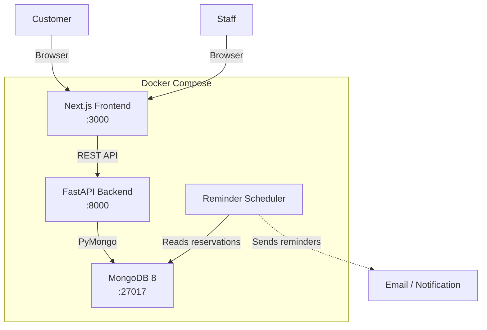

# Architecture

## Overview

The GIBZ Room Rental application replaces the current PDF-based reservation process with a web application. Customers can browse available rooms, create reservations, and complete event details online. Staff members manage reservations through a dashboard with filtering and CRUD operations.

The system follows a three-tier architecture: a Next.js frontend communicates with a FastAPI backend, which persists data in MongoDB. All services run in Docker Compose.

## Architecture Goals

- Keep the stack simple and appropriate for a school project
- Separate concerns between frontend, backend, and database
- Use a document-oriented database that fits naturally with reservation data
- Support multiple user roles without overcomplicating authentication
- Make the system easy to run locally with a single `docker compose up`

## High-Level Component Overview



## Frontend Architecture

The frontend is a Next.js 16 application using React 19, TypeScript, and Tailwind CSS 4.

**Key responsibilities:**
- Render the public room catalogue
- Provide reservation creation and editing forms
- Display the staff dashboard with filters
- Handle client-side form validation
- Communicate with the backend through a shared API client (`src/lib/api.ts`)

**Routing structure (planned):**

| Route | Purpose |
|---|---|
| `/` | Landing page / room catalogue |
| `/rooms/[id]` | Room detail and reservation form |
| `/reservations/[token]` | Customer edit view (token-based access) |
| `/staff/login` | Staff login page |
| `/staff/dashboard` | Staff reservation management |

The frontend uses Next.js server components for data fetching where possible. The API base URL is configured through environment variables (`API_BASE_URL` for server-side, `NEXT_PUBLIC_API_BASE_URL` for client-side).

## Backend Architecture

The backend is a FastAPI application using Python 3.12, structured as follows:

```
backend/
├── app/
│   ├── main.py           # FastAPI app, lifespan, CORS, router mounting
│   ├── config.py          # Pydantic Settings for environment config
│   ├── db.py              # MongoDB client and connection
│   ├── routers/
│   │   ├── reservations.py   # Reservation endpoints
│   │   ├── rooms.py          # Room endpoints (planned)
│   │   └── auth.py           # Staff authentication (planned)
│   ├── models/               # Pydantic models (planned)
│   ├── dao/                  # Data access objects (planned)
│   └── services/             # Business logic (planned)
```

**Current state:** The backend has a working reservation router with `POST /reservations` and `GET /reservations` endpoints. CORS is configured, and a health check endpoint exists at `/health`.

**Planned additions:**
- Room management endpoints
- Staff authentication endpoints
- Reservation update and delete endpoints
- DAO layer to abstract database access
- Service layer for business logic (conflict checking, deadline enforcement)
- Reminder scheduler

## Database Architecture

MongoDB 8 stores all application data. The database name is `room_rental`, configurable via environment variables.

**Collections:**

| Collection | Purpose |
|---|---|
| `reservations` | All reservation documents |
| `rooms` | Room definitions with capacity, equipment, setup variants (planned) |
| `staff` | Staff user accounts with roles (planned) |
| `config` | Application configuration values like deadlines (planned) |

**Reservation document structure (current):**

```json
{
  "_id": "ObjectId",
  "room_id": "string",
  "contact_name": "string",
  "contact_email": "string",
  "date": "string",
  "start_time": "string",
  "end_time": "string",
  "notes": "string | null",
  "created_at": "datetime"
}
```

**Planned fields for reservations:**
- `edit_token` — secure token for customer edit access
- `status` — e.g., `pending`, `confirmed`, `completed`, `cancelled`
- `catering` — catering requirements (to be filled before the event)
- `setup_variant` — room setup choice
- `materials` — additional material requests
- `reminder_sent` — whether a reminder has been sent
- `edit_deadline` — calculated deadline for customer edits

MongoDB's flexible schema allows these fields to be added incrementally without migrations.

## DAO / Repository Approach

Data access will be abstracted through a DAO (Data Access Object) layer. Each collection gets its own DAO class that encapsulates all database queries.

**Planned structure:**

```python
# dao/reservation_dao.py
class ReservationDAO:
    def __init__(self, db):
        self.collection = db.reservations

    async def create(self, data: dict) -> dict: ...
    async def find_by_id(self, id: str) -> dict | None: ...
    async def find_by_token(self, token: str) -> dict | None: ...
    async def update(self, id: str, data: dict) -> dict | None: ...
    async def delete(self, id: str) -> bool: ...
    async def find_with_filters(self, filters: dict) -> list[dict]: ...
```

This pattern keeps database logic out of route handlers and makes it easier to test business logic in isolation. The current implementation accesses `db.reservations` directly in the router — this will be refactored into the DAO layer.

## Authentication and Authorization

**Staff authentication (planned):**
- Staff members log in with username and password
- Passwords are hashed with bcrypt
- Sessions use JWT tokens stored in HTTP-only cookies
- Each staff account has a role: `secretariat`, `hausdienst`, `restaurant_treff`, or `admin`
- All staff roles can view and manage reservations; specific permissions may be refined later

**Customer access (planned):**
- Customers do not create accounts
- After creating a reservation, they receive a unique edit link containing a secure token
- The token grants access to view and edit their specific reservation until the edit deadline
- No login is required for customers

This approach avoids the complexity of a full customer account system while still allowing secure access to reservation data.

## Reminder / Notification Flow

A scheduled backend process checks for reservations approaching their event date that still have missing information (catering, setup variant, materials).

**Flow:**
1. A background task runs on a configurable interval (e.g., daily)
2. It queries reservations where `date` is within the reminder window and required fields are incomplete
3. For each match, it sends a reminder email to `contact_email` with the edit link
4. It marks the reservation as `reminder_sent = true` to avoid duplicate notifications

**Implementation approach (planned):**
- Use FastAPI's lifespan or a simple scheduler (e.g., APScheduler or a cron-like loop)
- Email sending via SMTP or a transactional email service
- The reminder window and other timing values are configurable

## Validation Strategy

Validation happens at multiple levels:

1. **Frontend:** Client-side form validation for immediate feedback (required fields, email format, date/time logic)
2. **API layer:** Pydantic models validate request payloads. The current `ReservationCreate` model already enforces `min_length` constraints and validates email format with `EmailStr`.
3. **Business logic (planned):** The service layer will enforce rules like:
   - No overlapping reservations for the same room and time
   - Edit deadline enforcement (reject changes after the deadline)
   - Required fields must be complete before the event date
4. **Database:** MongoDB schema validation can be added as a safety net but is not the primary validation mechanism

## Configuration Strategy

Application settings are managed through environment variables loaded via Pydantic Settings (`app/config.py`).

**Current configuration:**
- `APP_NAME` — application identifier
- `MONGODB_URL` — MongoDB connection string
- `MONGODB_DB` — database name
- `CORS_ORIGINS` — allowed CORS origins

**Planned configuration:**
- `EDIT_DEADLINE_DAYS` — number of days before the event when editing is locked
- `REMINDER_DAYS_BEFORE` — when to send reminders
- `SMTP_HOST`, `SMTP_PORT`, `SMTP_USER`, `SMTP_PASSWORD` — email settings
- `JWT_SECRET` — secret key for staff JWT tokens

Some configuration values (like room-specific settings) may also be stored in a `config` collection in MongoDB, allowing staff to adjust them without redeployment.

## Backup and Restore

MongoDB data is persisted in a Docker named volume (`mongodb_data`). For backup and restore:

- **Backup:** Use `mongodump` to export the database to a BSON archive
- **Restore:** Use `mongorestore` to import from a BSON archive
- **Frequency:** Manual backups before deployments or data changes; automated daily backups for a production-like setup

Example commands:

```bash
# Backup
docker exec room-rental-mongodb mongodump --db room_rental --archive=/tmp/backup.archive
docker cp room-rental-mongodb:/tmp/backup.archive ./backups/

# Restore
docker cp ./backups/backup.archive room-rental-mongodb:/tmp/backup.archive
docker exec room-rental-mongodb mongorestore --db room_rental --archive=/tmp/backup.archive --drop
```

See [DEPLOYMENT.md](DEPLOYMENT.md) for more details.

## Docker Compose Setup

The application runs as three services in Docker Compose:

| Service | Image | Port | Purpose |
|---|---|---|---|
| `mongodb` | `mongo:8` | 27017 | Database |
| `backend` | Custom (Python 3.12) | 8000 | REST API |
| `frontend` | Custom (Node 20) | 3000 | Web UI |

The backend depends on MongoDB being available. The frontend depends on the backend. MongoDB data is stored in a named volume (`mongodb_data`) to persist between container restarts.

See the [docker-compose.yml](../docker-compose.yml) and [DEPLOYMENT.md](DEPLOYMENT.md) for full configuration.

## Why a Modular Monolith

This project uses a modular monolith architecture — a single backend application with clear internal module boundaries — rather than microservices.

**Reasons:**
- **Simplicity:** A single FastAPI application is straightforward to develop, test, and deploy. There is no need for service discovery, API gateways, or inter-service communication.
- **Appropriate scale:** The application has a small number of clearly related features (rooms, reservations, reminders). Splitting these into separate services would add operational overhead without meaningful benefit.
- **Team size:** This is a student project developed by a small team. Microservices require coordination patterns that are unnecessary here.
- **Shared database:** All features operate on the same MongoDB database. Microservices would either share the database (defeating the purpose) or require data synchronization.
- **Easy evolution:** If the application ever grows beyond its current scope, the internal module structure (routers, DAOs, services) makes it possible to extract services later. But for this project, that complexity is not justified.

The modular structure — with separate routers, DAOs, and service modules — provides clean separation of concerns without the deployment complexity of distributed services.
