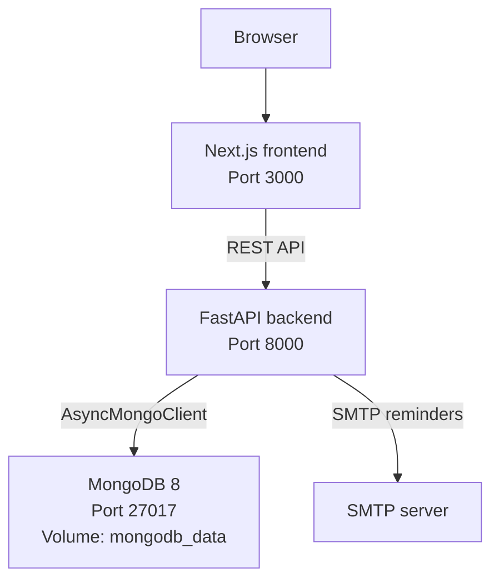

# M165 Project Documentation: GIBZ Room Rental

## 3.1 Additional Functions

The application replaces the PDF-based room reservation process with a
Dockerized web application for three GIBZ rooms: Aula 1.005, Seminarraum 2.112,
and Seminarraum 5.003/004.

Implemented:

- Public room catalogue and room detail pages with real GIBZ room data.
- Booking dialog with date/time selection, contact and billing details, room
  rules, catering, setup, publication options, and AGB acceptance.
- Reservation API with conflict detection, adjacent-booking support, room
  capacity/equipment validation, edit tokens, and edit deadlines.
- Customer edit page at `/reservation/edit/[token]`.
- Staff login with hashed passwords and HTTP-only JWT cookie sessions.
- Staff dashboard at `/staff` with filters, status updates, cancellation, and
  manual reminder sending.
- SMTP-backed reminder service for incomplete upcoming reservations.
- MongoDB persistence with collections for rooms, reservations, and users.
- Backup and restore scripts with a documented support runbook.
- Automated pytest suite covering the backend core behavior.

Not implemented by design:

- External calendar synchronization.
- Payment handling.
- Production SSO.
- Automated scheduled reminder jobs. Reminders are triggered manually by staff
  so they can be demonstrated and tested reliably.

## 3.2 Architecture Visualization

The application is a three-service Docker Compose system:



Main flows:

1. Customers browse rooms and submit reservations through the frontend.
2. The backend validates business rules and stores reservations in MongoDB.
3. Customers use edit-token links to update details until the edit deadline.
4. Staff log in through `/auth/login`; the backend sets an HTTP-only cookie.
5. Staff manage reservations and manually trigger reminders from `/staff`.

## 3.3 Technology Stack

| Area | Technology | Use |
|---|---|---|
| Frontend | Next.js 16, React 19, TypeScript | Web UI and staff dashboard |
| Styling | Tailwind CSS 4 | GIBZ-themed responsive layout |
| Backend | FastAPI, Pydantic 2 | REST API, validation, OpenAPI docs |
| Database | MongoDB 8 with PyMongo async | Room, reservation, and staff documents |
| Auth | bcrypt, PyJWT, HTTP-only cookies | Staff login/session handling |
| Email | Python `smtplib` | SMTP reminder delivery |
| Deployment | Docker Compose | Local/demo full-stack startup |
| Tests | pytest | Backend route/service/DAO tests |

MongoDB fits the project because reservations are document-shaped: contact,
billing, catering, setup, publication, reminder state, and edit-token fields
belong naturally in one reservation document.

## 3.4 Testing

Latest backend result:

```text
pytest -q
65 passed, 1 warning
```

Automated backend coverage includes:

- Health/root endpoints.
- Room catalogue endpoints.
- Reservation creation, listing, filters, validation, and conflict detection.
- Customer edit token lookup/update and edit-deadline rejection.
- Staff login/logout/me routes.
- Staff-only status update and cancellation routes.
- Reminder eligibility, SMTP configuration errors, and successful mocked send.
- DAO/service behavior with in-memory Mongo-style fakes.

Manual checks still required before final submission:

- `docker compose up --build` starts MongoDB, backend, and frontend.
- Public booking flow works in the browser.
- `/staff` login works with the demo staff account from `.env`.
- Staff filters/status actions/cancellation work.
- Reminder button returns a clear SMTP configuration error when SMTP is not set,
  or sends via a configured SMTP test server.
- Backup and restore scripts run successfully on a development database.

## 3.5 Installation Guide

### Prerequisites

- Docker v24 or newer.
- Docker Compose v2 or newer.
- Git.

For local development without Docker:

- Python 3.12 or newer.
- Node.js 20 or newer.
- MongoDB 8 or a reachable MongoDB connection string.

### Configure Backend

Create `backend/.env` from the example:

```powershell
Copy-Item backend\.env.example backend\.env
```

For local Docker demos, the example enables a demo staff user:

```text
SEED_STAFF_USERNAME=secretariat
SEED_STAFF_PASSWORD=ChangeMe123!
```

Change `AUTH_SECRET_KEY` and staff credentials before any non-demo use.

### Start with Docker Compose

From the repository root:

```bash
docker compose up --build
```

After startup:

- Frontend: `http://localhost:3000`
- Staff dashboard: `http://localhost:3000/staff`
- Backend API: `http://localhost:8000`
- Swagger UI: `http://localhost:8000/docs`
- Health check: `http://localhost:8000/health`
- MongoDB: `localhost:27017`

To stop:

```bash
docker compose down
```

To delete local MongoDB data:

```bash
docker compose down -v
```

### Backup and Restore

The complete support runbook is in `docs/BACKUP_RESTORE.md`.

Create a backup:

```powershell
.\scripts\backup-mongodb.ps1
```

Restore a backup:

```powershell
.\scripts\restore-mongodb.ps1 -ArchivePath .\backups\room_rental-YYYYMMDD-HHMMSS.archive.gz -ConfirmDataLoss
```

## 3.6 Conclusion

The project now demonstrates the complete core workflow: customers can reserve
rooms, conflicts are blocked, customers can edit through secure links, and staff
can manage reservations through a protected dashboard. The MongoDB document
model is used for realistic nested reservation data, and Docker Compose makes
the system easy to start for evaluation.

The remaining limitations are acceptable for a school project: reminders are
manual rather than scheduled, SMTP depends on external configuration, and there
is no integration with GIBZ SSO or external calendars.
