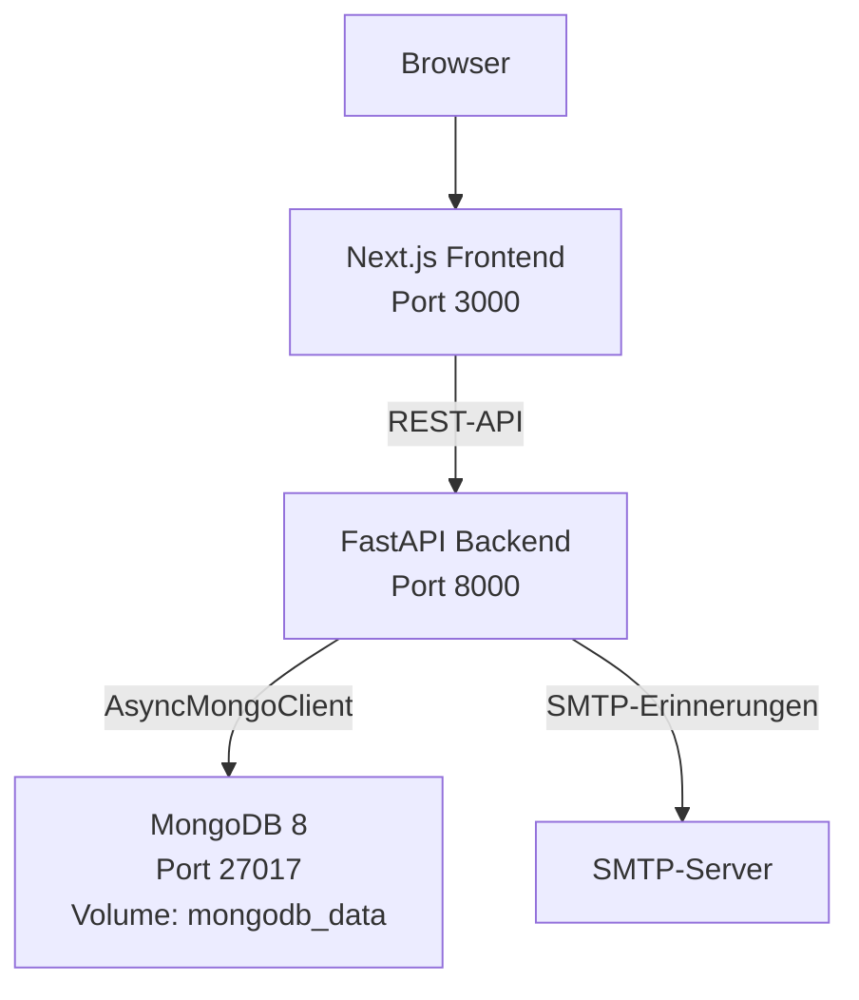

# M165 Projektdokumentation: GIBZ Raumvermietung

## 3.1 Zusätzliche Funktionen

Die Anwendung ersetzt den bisherigen PDF-basierten Raumreservationsprozess durch
eine dockerisierte Webanwendung für drei GIBZ-Räume: Aula 1.005,
Seminarraum 2.112 und Seminarraum 5.003/004.

Umgesetzt:

- Öffentliches Raumverzeichnis und Raumdetailseiten mit realen GIBZ-Raumdaten.
- Buchungsdialog mit Datum-/Zeitauswahl, Kontakt- und Rechnungsdaten,
  Raumregeln, Catering, Einrichtung, Publikationsoptionen und AGB-Akzeptanz.
- Reservations-API mit Konflikterkennung, Unterstützung direkt anschliessender
  Buchungen, Validierung von Raumkapazität und Ausstattung, Bearbeitungstokens
  und Bearbeitungsfristen.
- Kundenseitige Bearbeitungsseite unter `/reservation/edit/[token]`.
- Mitarbeitenden-Login mit gehashten Passwörtern und HTTP-only-JWT-Cookie-
  Sessions.
- Mitarbeitenden-Dashboard unter `/staff` mit Filtern, Statusänderungen,
  Stornierung und manuellem Versand von Erinnerungen.
- SMTP-gestützter Erinnerungsdienst für unvollständige bevorstehende
  Reservationen.
- MongoDB-Persistenz mit Collections für Räume, Reservationen und Benutzer.
- Backup- und Restore-Skripte mit dokumentiertem Support-Runbook.
- Automatisierte pytest-Suite für das zentrale Backend-Verhalten.

Bewusst nicht umgesetzt:

- Externe Kalendersynchronisation.
- Zahlungsabwicklung.
- Produktives SSO.
- Automatisch geplante Erinnerungsjobs. Erinnerungen werden von Mitarbeitenden
  manuell ausgelöst, damit sie zuverlässig demonstriert und getestet werden
  können.

## 3.2 Architekturvisualisierung

Die Anwendung ist ein Docker-Compose-System mit drei Diensten:



Hauptabläufe:

1. Kunden durchsuchen die Räume und erfassen Reservationen über das Frontend.
2. Das Backend validiert die Geschäftsregeln und speichert Reservationen in
   MongoDB.
3. Kunden verwenden Bearbeitungstoken-Links, um Details bis zur
   Bearbeitungsfrist anzupassen.
4. Mitarbeitende melden sich über `/auth/login` an; das Backend setzt ein
   HTTP-only-Cookie.
5. Mitarbeitende verwalten Reservationen und lösen Erinnerungen manuell über
   `/staff` aus.

## 3.3 Technologie-Stack

| Bereich | Technologie | Einsatz |
|---|---|---|
| Frontend | Next.js 16, React 19, TypeScript | Web-UI und Mitarbeitenden-Dashboard |
| Styling | Tailwind CSS 4 | Responsives Layout im GIBZ-Stil |
| Backend | FastAPI, Pydantic 2 | REST-API, Validierung, OpenAPI-Dokumentation |
| Datenbank | MongoDB 8 mit PyMongo async | Raum-, Reservations- und Mitarbeitenden-Dokumente |
| Authentifizierung | bcrypt, PyJWT, HTTP-only-Cookies | Mitarbeitenden-Login und Session-Verwaltung |
| E-Mail | Python `smtplib` | Versand von SMTP-Erinnerungen |
| Deployment | Docker Compose | Lokaler/Demo-Start des Full Stacks |
| Tests | pytest | Backend-Tests für Routen, Services und DAOs |

MongoDB passt gut zum Projekt, weil Reservationen dokumentenartig aufgebaut
sind: Kontakt, Rechnungsdaten, Catering, Einrichtung, Publikation,
Erinnerungsstatus und Bearbeitungstoken gehören sinnvoll in ein gemeinsames
Reservationsdokument.

## 3.4 Tests

Aktuelles Backend-Resultat:

```text
pytest -q
65 passed, 1 warning
```

Die automatisierte Backend-Abdeckung umfasst:

- Health- und Root-Endpunkte.
- Endpunkte des Raumverzeichnisses.
- Erstellung, Auflistung, Filterung, Validierung und Konflikterkennung von
  Reservationen.
- Kundenseitige Bearbeitungstoken-Suche/-Aktualisierung und Ablehnung nach
  Ablauf der Bearbeitungsfrist.
- Mitarbeitenden-Routen für Login, Logout und `/me`.
- Nur für Mitarbeitende zugängliche Routen für Statusänderungen und
  Stornierungen.
- Erinnerungsberechtigung, SMTP-Konfigurationsfehler und erfolgreich gemockter
  Versand.
- DAO-/Service-Verhalten mit Mongo-ähnlichen In-Memory-Fakes.

Vor der finalen Abgabe sind noch folgende manuelle Prüfungen erforderlich:

- `docker compose up --build` startet MongoDB, Backend und Frontend.
- Der öffentliche Buchungsablauf funktioniert im Browser.
- Der Login unter `/staff` funktioniert mit dem Demo-Mitarbeitendenkonto aus
  `.env`.
- Filter, Statusaktionen und Stornierung im Mitarbeitendenbereich funktionieren.
- Der Erinnerungsbutton gibt bei fehlender SMTP-Konfiguration eine klare
  Fehlermeldung zurück oder versendet über einen konfigurierten
  SMTP-Testserver.
- Backup- und Restore-Skripte laufen erfolgreich gegen eine
  Entwicklungsdatenbank.

## 3.5 Installationsanleitung

### Voraussetzungen

- Docker v24 oder neuer.
- Docker Compose v2 oder neuer.
- Git.

Für lokale Entwicklung ohne Docker:

- Python 3.12 oder neuer.
- Node.js 20 oder neuer.
- MongoDB 8 oder ein erreichbarer MongoDB-Connection-String.

### Backend konfigurieren

`backend/.env` aus der Beispieldatei erstellen:

```powershell
Copy-Item backend\.env.example backend\.env
```

Für lokale Docker-Demos aktiviert die Beispieldatei einen
Demo-Mitarbeitendenbenutzer:

```text
SEED_STAFF_USERNAME=secretariat
SEED_STAFF_PASSWORD=ChangeMe123!
```

`AUTH_SECRET_KEY` und Mitarbeitenden-Zugangsdaten müssen vor jeder Nutzung
ausserhalb einer Demo angepasst werden.

### Start mit Docker Compose

Aus dem Repository-Root:

```bash
docker compose up --build
```

Nach dem Start:

- Frontend: `http://localhost:3000`
- Mitarbeitenden-Dashboard: `http://localhost:3000/staff`
- Backend API: `http://localhost:8000`
- Swagger UI: `http://localhost:8000/docs`
- Health-Check: `http://localhost:8000/health`
- MongoDB: `localhost:27017`

Stoppen:

```bash
docker compose down
```

Lokale MongoDB-Daten löschen:

```bash
docker compose down -v
```

### Backup und Restore

Das vollständige Support-Runbook befindet sich in `docs/BACKUP_RESTORE.md`.

Backup erstellen:

```powershell
.\scripts\backup-mongodb.ps1
```

Backup wiederherstellen:

```powershell
.\scripts\restore-mongodb.ps1 -ArchivePath .\backups\room_rental-YYYYMMDD-HHMMSS.archive.gz -ConfirmDataLoss
```

## 3.6 Fazit

Das Projekt demonstriert nun den vollständigen Kernprozess: Kunden können Räume
reservieren, Konflikte werden verhindert, Kunden können ihre Reservationen über
sichere Links bearbeiten, und Mitarbeitende können Reservationen über ein
geschütztes Dashboard verwalten. Das MongoDB-Dokumentmodell wird für realistische
verschachtelte Reservationsdaten genutzt, und Docker Compose ermöglicht einen
einfachen Systemstart für die Bewertung.

Die verbleibenden Einschränkungen sind für ein Schulprojekt akzeptabel:
Erinnerungen werden manuell statt geplant ausgelöst, SMTP hängt von externer
Konfiguration ab, und es gibt keine Integration mit GIBZ-SSO oder externen
Kalendern.
