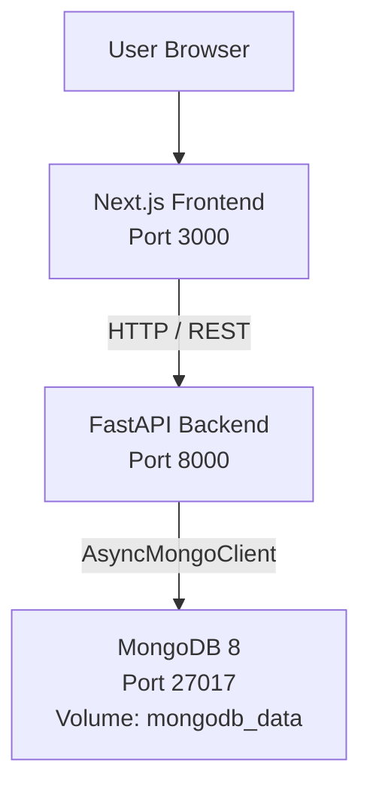

# M165 Project Documentation: GIBZ Room Rental

## 3.1 Additional Functions

The current implementation is a technical baseline for the room rental application. It includes a Dockerized full-stack structure, a reservation API, and a room catalogue based on the real GIBZ room data.

Implemented:

- Docker Compose setup for frontend, backend, and MongoDB.
- FastAPI backend with health check endpoints.
- Reservation creation via `POST /reservations` with the core fields from the reservation form.
- Reservation listing via `GET /reservations`.
- MongoDB persistence for reservation documents.
- Room catalogue via `GET /rooms`, seeded in MongoDB from the real GIBZ room data.
- Public room catalogue and detail pages for Aula 1.005, Seminarraum 2.112, and Seminarraum 5.003/004.
- Frontend health display that verifies the backend connection.

Planned but not yet implemented:

- Customer edit links for completing catering, setup, and material details later.
- Configurable edit deadlines before the event date.
- Automatic reminders for incomplete reservation details.
- Staff dashboard for secretariat, facility management, and Restaurant Treff.
- Staff authentication, roles, filters, and full CRUD reservation management.

The current project therefore demonstrates the technical foundation and the public room catalogue, but not yet the complete functional scope required for the final submission.

## 3.2 Architecture Visualization

The application is structured as a simple three-service system:



Current flow:

1. The browser opens the Next.js frontend at `http://localhost:3000`.
2. The frontend calls the backend health endpoint through `src/lib/api.ts`.
3. The FastAPI backend exposes REST endpoints and connects to MongoDB.
4. Room documents are stored in the `rooms` collection.
5. Reservation documents are stored in the `reservations` collection.
6. MongoDB data is persisted in the Docker named volume `mongodb_data`.

Planned final architecture:

- Add staff, authentication, and configuration collections.
- Add service-layer logic for conflict detection, edit deadlines, reminders, and staff filters.
- Add frontend routes for reservation editing and staff dashboard.

## 3.3 Technology Stack

| Area | Technology | Current use |
|---|---|---|
| Frontend | Next.js 16.2.2 | Web frontend and server-rendered home page |
| Frontend language | TypeScript | Type-safe frontend source files |
| UI library | React 19.2.4 | Component-based frontend |
| Styling | Tailwind CSS 4 | Global styling via `globals.css` |
| Backend | FastAPI 0.135.3 | REST API and Swagger documentation |
| Backend language | Python 3.12 | Backend runtime |
| Validation | Pydantic 2.12.5 | Request and response models |
| Database driver | PyMongo 4.16.0 | Async MongoDB access |
| Database | MongoDB 8 | NoSQL document database |
| Containerization | Docker and Docker Compose | Local/demo deployment |
| ASGI server | Uvicorn 0.44.0 | Runs the FastAPI application |

MongoDB was selected because the assignment requires a NoSQL database and reservation data fits a document-oriented model. A reservation can later contain nested fields such as catering, setup variant, material requirements, reminder state, and edit deadline without requiring a relational schema migration.

FastAPI was selected because it provides automatic OpenAPI documentation, strong request validation through Pydantic, and a simple structure for REST endpoints. Next.js was selected for the frontend because it provides a modern React-based setup with TypeScript support and straightforward routing for the planned room and staff pages.

## 3.4 Testing

The repository now includes focused backend pytest tests for reservation creation and validation. Manual API testing is still useful for Docker/MongoDB verification.

Current test scenarios:

- Start the stack with `docker compose up --build`.
- Open the frontend at `http://localhost:3000` and verify that the backend health JSON is displayed.
- Open the backend health endpoint at `http://localhost:8000/health` and verify that it returns status `ok`.
- Open Swagger UI at `http://localhost:8000/docs`.
- Create a reservation through `POST /reservations` with valid reservation data.
- Call `GET /reservations` and verify that the created reservation appears in the response.
- Submit invalid reservation data, for example an invalid email address, invalid time order, rejected terms, invalid organizer type, or non-positive attendee count, and verify that FastAPI/Pydantic returns validation errors.
- Restart the Docker stack without deleting volumes and verify that MongoDB data is still present.

Automated tests currently cover:

- Successful `POST /reservations` creation.
- Email validation.
- Positive attendee count validation.
- Organizer type validation.
- Terms acceptance validation.
- Time-order validation.
- Room ID validation.
- Reservation overlap conflict detection.
- Typed `GET /reservations` response.
- Room-specific capacity/equipment validation.

Recommended automated tests for the next iteration:

- API tests for `GET /reservations` and `/health`.
- Integration tests against a separate MongoDB test database.
- Future tests for conflict detection, edit deadlines, staff authentication, filters, and reminder logic once those features are implemented.

## 3.5 Installation Guide

### Prerequisites

- Docker v24 or newer.
- Docker Compose v2 or newer.
- Git.

For local development without Docker:

- Python 3.12 or newer.
- Node.js 20 or newer.
- MongoDB 8 or a reachable MongoDB connection string.

### Start with Docker Compose

From the repository root:

```bash
docker compose up --build
```

After startup:

- Frontend: `http://localhost:3000`
- Backend API: `http://localhost:8000`
- Swagger UI: `http://localhost:8000/docs`
- Health check: `http://localhost:8000/health`
- MongoDB: `localhost:27017`

To stop the stack:

```bash
docker compose down
```

To stop the stack and delete MongoDB data:

```bash
docker compose down -v
```

### Backend configuration

The backend reads configuration from environment variables through Pydantic Settings. In Docker Compose, the backend uses `backend/.env`.

| Variable | Default | Purpose |
|---|---|---|
| `APP_NAME` | `room-rental-api` | API name used by FastAPI |
| `MONGODB_URL` | `mongodb://localhost:27017` | MongoDB connection string |
| `MONGODB_DB` | `room_rental` | MongoDB database name |
| `CORS_ORIGINS` | `http://localhost:3000` | Allowed frontend origins |

When running inside Docker Compose, `MONGODB_URL` must point to the service name, for example `mongodb://mongodb:27017`.

### Frontend configuration

| Variable | Purpose |
|---|---|
| `API_BASE_URL` | Backend URL used by server-side frontend code |
| `NEXT_PUBLIC_API_BASE_URL` | Backend URL used by browser/client-side frontend code |

The Docker Compose file sets `API_BASE_URL` to `http://backend:8000` and `NEXT_PUBLIC_API_BASE_URL` to `http://localhost:8000`.

### Backup and restore

Create a MongoDB backup:

```bash
docker exec room-rental-mongodb mongodump --db room_rental --archive=/tmp/room_rental_backup.archive
docker cp room-rental-mongodb:/tmp/room_rental_backup.archive ./backups/
```

Restore a MongoDB backup:

```bash
docker cp ./backups/room_rental_backup.archive room-rental-mongodb:/tmp/
docker exec room-rental-mongodb mongorestore --db room_rental --archive=/tmp/room_rental_backup.archive --drop
```

## 3.6 Conclusion

The project currently provides a working technical foundation for the GIBZ room rental application. The frontend, backend, database, and Docker Compose setup are connected, and reservation creation/listing is available through the API with the main reservation form fields.

The strongest current parts are the simple deployment model, the clear separation between frontend/backend/database services, and the use of MongoDB as a NoSQL document database. The main missing parts are the user-facing room catalogue, the staff dashboard, business-rule validation such as reservation conflict detection, automatic reminders, and the DAO layer required by the assignment.

The next development step should be to implement the missing core workflows before expanding the documentation into a final PDF submission.
